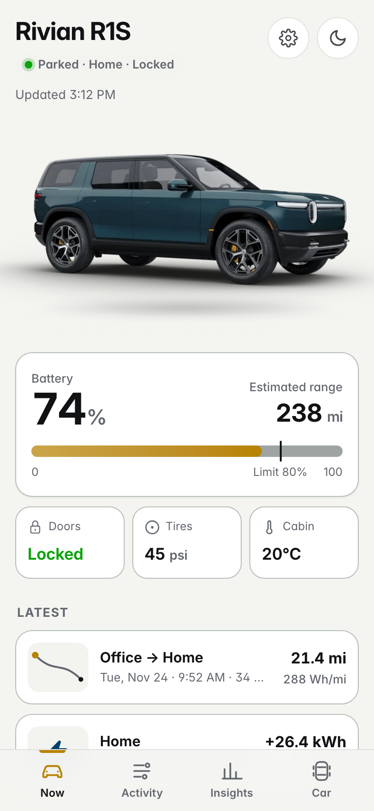
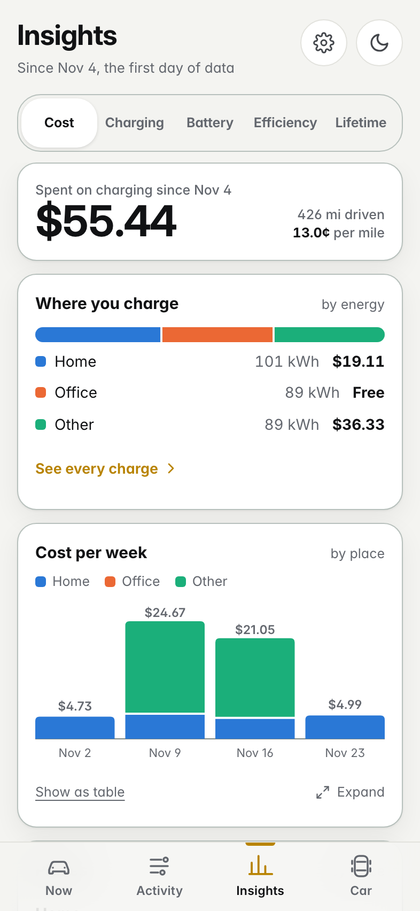
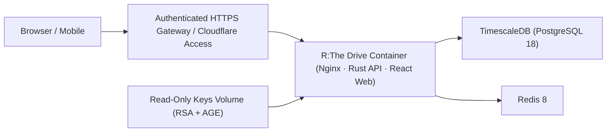

<div align="center">
  <picture>
    <source media="(prefers-color-scheme: dark)" srcset="./docs/assets/readme/logo-lockup-dark.png" />
    
  </picture>

  <h1>R:The Drive</h1>

  <p><strong>Your Rivian. Your history. Your server.</strong></p>

  <p>
    A private, self-hosted telemetry application for Rivian owners.<br />
    Live vehicle state, interactive trip replay, curve-level charging with per-session costing, and long-term battery health — responsive across desktop and mobile in light and dark modes, with zero third-party analytics.
  </p>

  <p>
    <a href="./LICENSE">
      
    </a>
    
  </p>

  <p>
    <a href="#see-it-in-action">Walkthrough</a> ·
    <a href="#quick-start">Quick Start</a> ·
    <a href="#interface-preview">Screenshots</a> ·
    <a href="#what-you-can-do">Features</a> ·
    <a href="#architecture--security">Architecture</a> ·
    <a href="./docs/index.md">Documentation</a>
  </p>
</div>

---

## See it in action

Explore the `Now` vehicle stage, `Activity` trip &amp; charge replay, `Insights` hubs, and `Car` diagnostics in this walkthrough:

https://github.com/user-attachments/assets/8cce2271-66e9-43dd-9d07-6ae6c45e72b1

---

## Quick start

Choose the setup path that matches where you want to run **R:The Drive**:

| Path | Target environment | Prerequisites | Command |
| --- | --- | --- | --- |
| [**Self-Hosted Production**](#option-1--one-command-self-hosted-production-install) | Linux/macOS host, home server, NAS, or VPS | Git, Python 3, Docker Compose v2, and an HTTPS reverse proxy/tunnel to `127.0.0.1:8080` | `python3 scripts/deploy.py` |
| [**Local Dev Stack**](#option-2--one-command-local-development-stack) | macOS, Linux, or Windows workstation | Docker, Rust (`cargo`), Node `24.18+`, and `pnpm` `11.15+` | `pnpm dev:stack` |
| [**Cloud Free Tier**](#option-3--cloud-free-tier-blueprint-northflank--cloudflare) | Managed container + Zero-Trust edge SSO | Northflank Sandbox + Cloudflare Workers &amp; Access | Guided below |

### Option 1 — One-command self-hosted production install

Run directly on the Docker host you manage, fronted by an authenticated HTTPS gateway (Cloudflare Tunnel, Tailscale, Caddy, or Nginx) forwarding to `http://127.0.0.1:8080`:

```bash
git clone https://github.com/rahulrsingh09/r-the-drive.git && cd r-the-drive && python3 scripts/deploy.py --project r-the-drive --origin https://drive.yourdomain.com
```

What [`scripts/deploy.py`](./scripts/deploy.py) automates end-to-end:

1. **Builds &amp; isolates credentials** — Builds the unified production container from [`compose/Dockerfile`](./compose/Dockerfile), creates an external read-only `r-the-drive-keys` Docker volume holding generated RSA signing and AGE encryption keys, and provisions separate PostgreSQL/TimescaleDB bootstrap (`panda_bootstrap`), restricted runtime (`panda`), and Redis credentials in owner-only (`0600`) `.env` and `.deploy/` files.
2. **Registers the first owner** — Starts the stack, prompts locally for your owner email and password (at least 16 characters), verifies registration over `127.0.0.1:8080`, and atomically removes the one-time `PANDA_SETUP_TOKEN` from `.env`.
3. **Keeps services private** — Publishes only `127.0.0.1:8080` (database and Redis ports stay unpublished). Open your HTTPS address, sign in, and complete the guided Rivian OTP connection flow. Back up the `r-the-drive-keys` volume separately using the [key-custody runbook](./docs/runbooks/key-custody.md).

<details>
<summary>Installer options, retries, updates &amp; Synology DSM guide</summary>

| Flag / Command | Default | Purpose |
| --- | --- | --- |
| `--origin` | Required on setup | Exact HTTPS gateway origin (no path, query, or fragment), e.g. `https://drive.yourdomain.com`. |
| `--project` | `vehicle-history` | Namespaces Docker containers and volumes (`--project r-the-drive` creates `r-the-drive-keys`). |
| `--port` | `8080` | Loopback port (`127.0.0.1:<port>`, `1024`–`65535`). |
| `--image` | Local build (`<project>:local`) | Optional digest-pinned image (`registry/image@sha256:...`) instead of building locally. |
| `python3 scripts/deploy.py start` | — | Safely resumes database provisioning, container startup, or owner registration using saved `.deploy/settings.json` without overwriting data or keys. |

- Step-by-step host &amp; gateway setup: [Installation guide](./docs/guides/getting-started.md) and [Secure deployment guide](./docs/guides/secure-deployment.md).
- Synology NAS installation: [Synology DSM guide](./docs/guides/synology.md).
- Upgrades, logs &amp; host migration: [Deployment and updates](./docs/guides/deployment.md).

</details>

### Option 2 — One-command local development stack

To run or develop locally on macOS, Linux, or Windows (requires Docker, Rust/`cargo`, Node `24.18+`, and `pnpm` `11.15+`; on Linux also install `pkg-config` and OpenSSL development headers):

```bash
git clone https://github.com/rahulrsingh09/r-the-drive.git && cd r-the-drive && corepack enable && pnpm install && pnpm dev:stack
```

[`scripts/dev.mjs`](./scripts/dev.mjs) starts local TimescaleDB, Redis, and Garage S3 containers via [`compose/docker-compose.dev.yml`](./compose/docker-compose.dev.yml), compiles and supervises `panda-api` and `panda-restore-agent`, and launches the Vite web app at `http://localhost:5173`.

### Option 3 — Cloud free-tier blueprint (Northflank + Cloudflare)

<details>
<summary>Run 24/7 in the cloud on free tiers using Northflank Sandbox + Cloudflare Access</summary>

R:The Drive can run in a managed cloud environment within Northflank and Cloudflare free-tier limits:

1. **Northflank Sandbox (`nf-compute-20`):** Deploy the unified container built from [`compose/Dockerfile`](./compose/Dockerfile) alongside a TimescaleDB/PostgreSQL addon and Redis service, with `PANDA_REQUIRE_GATEWAY=true` and a shared gateway token enforcing edge authentication.
2. **Cloudflare Access + Private Gateway Worker:** Put [`apps/private-gateway`](./apps/private-gateway/wrangler.example.json) in front of the Northflank origin on a `workers.dev` or custom domain protected by a Cloudflare Access email allowlist, injecting `X-Panda-Edge` only after RS256 Access JWT verification.
3. **Automatic `git push` deploys:** Enable [`.github/workflows/auto-deploy.yml`](./.github/workflows/auto-deploy.yml) with a Northflank deploy webhook repository secret so pushes to `mainline` automatically trigger Northflank image builds and rollouts (skipping pure `*.md` / `docs/**` edits and `[skip nf]` commits).

Review [Private deployment architecture](./docs/architecture/private-deployment.md) and [Deployment options](./docs/guides/deployment.md#deployment-options-and-moving-hosts) for full details.

</details>

---

## Interface preview

Rendered directly from the `R` web application (automatically switches between dark and light themes on GitHub; uses illustrative, non-personal vehicle data).

<table>
  <tr>
    <th width="68%">Desktop — <code>Now</code> Stage &amp; <code>Insights · Cost</code></th>
    <th width="32%">Mobile</th>
  </tr>
  <tr>
    <td align="center">
      <picture>
        <source media="(prefers-color-scheme: dark)" srcset="./docs/assets/readme/overview-desktop-dark.png" />
        
      </picture>
    </td>
    <td align="center">
      <picture>
        <source media="(prefers-color-scheme: dark)" srcset="./docs/assets/readme/overview-mobile-dark.png" />
        
      </picture>
    </td>
  </tr>
  <tr>
    <td align="center">
      <picture>
        <source media="(prefers-color-scheme: dark)" srcset="./docs/assets/readme/charging-desktop-dark.png" />
        
      </picture>
    </td>
    <td align="center">
      <picture>
        <source media="(prefers-color-scheme: dark)" srcset="./docs/assets/readme/charging-mobile-dark.png" />
        
      </picture>
    </td>
  </tr>
</table>

---

## What you can do

- **`Now` (`/`):** Live parked, charging, or driving view — interactive 360° vehicle stage, battery state of charge with charge-limit marker, estimated range, drive mode, cabin/outside temperatures, tire pressures, lock/closure status, software version, latest drive &amp; charge cards, 7-day strip, and 30-day summary.
- **`Activity` (`/trips`):** Chronological feed of recorded drives, charge sessions, and 10h+ parked periods with interactive GPS route replay, charge-level and power curves, odometer reconciliation, per-session **Home / Office / Other** place tagging, and per-session manual or free (`$0`) cost overrides that leave previous sessions untouched.
- **`Insights` (`/insights`):** Five dedicated views:
  - **Cost:** Total charging spend, cents per mile, Home/Office/Other energy split, weekly cost bars, per-place summaries, and gas-car savings calculator.
  - **Charging:** Total kWh, AC vs. DC session breakdown, pack-equivalent cycles, charging calendar, and session time windows.
  - **Battery:** Usable capacity health tracking over time and validated 30-day parked battery loss.
  - **Efficiency:** Distance-weighted `Wh/mi` or `mi/kWh` trends across speed and outside-temperature bands (excluding sub-3-mile coarse trips).
  - **Lifetime:** Odometer coverage vs. recorded trip miles and monthly mileage/energy ledger.
- **`Car` (`/vehicle-health`):** Per-wheel tire pressures, door/frunk/liftgate lock and closure states, 12V and thermal indicators, live collector health, and OTA software history.
- **Settings, Backups &amp; Multi-User Access (`/settings`):** Guided Rivian OTP sign-in and missed-charge backfill recovery, Home &amp; Office kWh rates, unit and theme preferences, encrypted local/S3 backups, and multi-user invitations with per-vehicle `owner`, `manager`, or `viewer` roles.

> **Honest telemetry:** The application displays the readings Rivian makes available. Sleeping vehicles and unavailable signals naturally leave gaps; missing readings are never presented as measured values.

---

## Architecture & security



- **Read-only vehicle connectivity:** Connects to Rivian strictly read-only — no remote lock, climate, or vehicle control commands exist.
- **Defense in depth:** Gateway edge-token &amp; origin enforcement, Argon2id password hashing, RS256 access tokens with rotating refresh-token families, AGE-encrypted vehicle credentials backed by external read-only keys, and least-privilege runtime database roles (non-superuser, history-deletion privileges revoked).
- **Explicit external connections:** Your telemetry stays in the database and backups you operate, with no product analytics trackers. Weather enrichment (approximate coordinates to fixed Open-Meteo endpoints) and S3 backups start disabled; API map/geocoding providers cannot be enabled in Settings unless supplied by a separately configured gateway.

See [Security](./docs/security.md), [Privacy details](./docs/privacy.md), [External connections](./docs/guides/external-connections.md), [Backup and restore](./docs/guides/backup-and-restore.md), and [Bootstrap validation](./BOOTSTRAP_VALIDATION.md).

---

## Documentation & development

- [Documentation Hub](./docs/index.md): Installation, usage, operations, and reference material.
- [Installation Guide](./docs/guides/getting-started.md): Standard Docker Compose setup and owner registration.
- [Vehicle Account Setup](./docs/guides/rivian-account.md): Connect an account and complete MFA or credential renewal.
- [Configuration Reference](./docs/guides/configuration.md) &amp; [Environment Variables](./docs/environment-variables.md): Runtime settings, keys, and optional integrations.
- [Development Guide](./docs/development.md) &amp; [Contributor Setup](./CLAUDE.md): Local stack commands, architecture guards, and test suites.

---

## License

Licensed under [GPL-3.0-only](./LICENSE). See [Notices](./NOTICE.md) for attribution and the dated modification notice.
