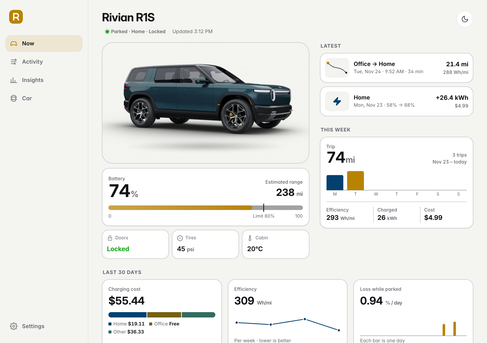
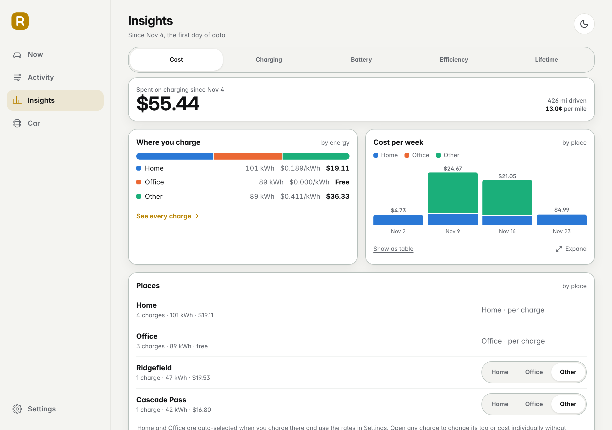
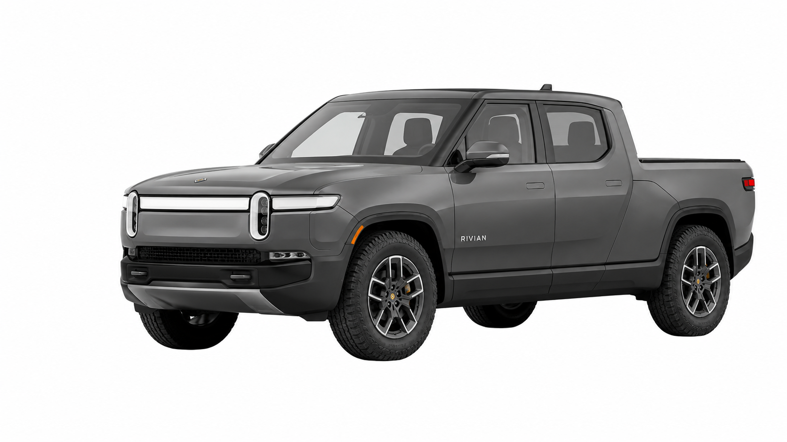
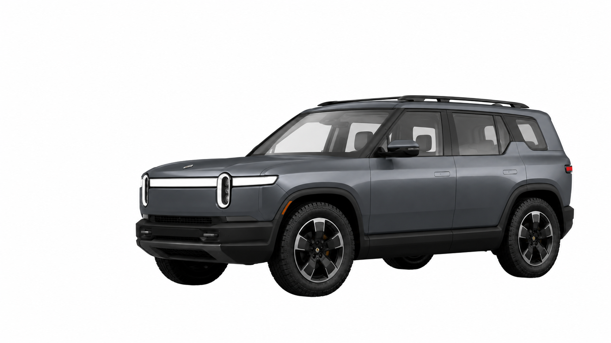
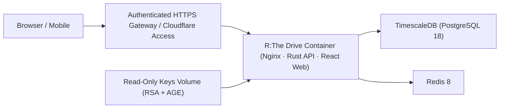

<div align="center">
  <picture>
    <source media="(prefers-color-scheme: dark)" srcset="./docs/assets/readme/logo-lockup-dark.png" />
    
  </picture>

  <h1>R:The Drive</h1>

  <p><strong>Your Rivian. Your history. Your server.</strong></p>

  <p>
    A private, self-hosted telemetry companion for R1T, R1S, and R2 owners.<br />
    Live vehicle state, interactive trip replay, curve-level charging with per-session costing, and long-term battery health — with desktop and mobile light/dark modes and zero third-party analytics.
  </p>

  <p>
    <a href="https://codespaces.new/rahulrsingh09/r-the-drive?quickstart=1">
      
    </a>
    <a href="./LICENSE">
      
    </a>
    
  </p>

  <p>
    <a href="#see-it-in-action">Walkthrough</a> ·
    <a href="#quick-start">Quick Start</a> ·
    <a href="#interface-preview">Screenshots</a> ·
    <a href="#what-you-can-do">Features</a> ·
    <a href="#architecture--security">Architecture</a> ·
    <a href="./docs/index.md">Documentation</a>
  </p>
</div>

---

## See it in action

Explore the live vehicle stage, trip replay, charging curve analysis, and Insights hubs in this walkthrough:

https://github.com/user-attachments/assets/8cce2271-66e9-43dd-9d07-6ae6c45e72b1

---

## Quick start

Pick the launch path that fits where you want to run **R:The Drive**:

| Path | Best for | Setup effort | Built-in Demo R1T / R1S / R2 |
| --- | --- | --- | --- |
| [**GitHub Codespaces**](#option-1--one-click-in-your-browser-codespaces) | Instant browser preview with zero local install | **1 click** | Yes |
| [**Docker Self-Host**](#option-2--one-command-self-hosted-production-install) | Private 24/7 home server, NAS, or VPS | **1 command** | Yes |
| [**Local Dev Stack**](#option-3--one-command-local-trial) | Trying or developing on macOS / Linux | **1 command** | Yes |
| [**Cloud Free Tier**](#free-tier-cloud-blueprint-northflank--cloudflare) | Managed cloud hosting behind Cloudflare Access SSO | **Guided** | Yes |

### Option 1 — One-click in your browser (Codespaces)

[](https://codespaces.new/rahulrsingh09/r-the-drive?quickstart=1)

Clicking **Open in GitHub Codespaces** uses [the devcontainer configuration](./.devcontainer/devcontainer.json) to provision Docker, Node 24, Rust, TimescaleDB, and Redis and automatically run `pnpm dev:stack`. Open the forwarded port `5173` URL to explore **Demo R1T / R1S / R2** vehicles immediately or test with your Rivian account.

### Option 2 — One-command self-hosted production install

Run directly on a trusted Linux or macOS server with Git, Python 3, Docker Engine, and Docker Compose v2, fronted by an authenticated HTTPS gateway (Cloudflare Tunnel, Tailscale, Caddy, or Nginx) pointing to `http://127.0.0.1:8080`:

```bash
git clone https://github.com/rahulrsingh09/r-the-drive.git && cd r-the-drive && python3 scripts/deploy.py --project r-the-drive --origin https://drive.yourdomain.com
```

What this single installer command does automatically:

1. **Builds & hardens the stack** — Builds the unified app/API image, creates an isolated read-only `r-the-drive-keys` volume with RSA and AGE custody keys, and provisions separate database bootstrap, restricted application (`panda`), and Redis credentials.
2. **Creates your owner account** — Prompts once in the terminal for your email and password (16+ characters), registers the owner, and deletes the one-time setup token (`PANDA_SETUP_TOKEN`).
3. **Binds privately to `127.0.0.1:8080`** — Open your HTTPS origin, sign in, and connect your Rivian account. Back up the `r-the-drive-keys` volume off-host using the [key-custody runbook](./docs/runbooks/key-custody.md).

<details>
<summary>Installer flags, retries, updates &amp; Synology DSM setup</summary>

| Flag / Command | Default | Purpose |
| --- | --- | --- |
| `--origin` | Required on setup | Exact HTTPS gateway origin, e.g. `https://drive.yourdomain.com`. |
| `--project` | `vehicle-history` | Namespaces containers and volumes (`r-the-drive` creates `r-the-drive-keys`). |
| `--port` | `8080` | Localhost bind port (`127.0.0.1:<port>`). |
| `--image` | Local build | Optional prebuilt digest (`registry/image@sha256:...`). |
| `python3 scripts/deploy.py start` | — | Safely resumes startup or owner registration without overwriting data or keys. |

- Full walkthrough & prerequisites: [Installation guide](./docs/guides/getting-started.md) and [Secure deployment guide](./docs/guides/secure-deployment.md).
- Synology NAS walkthrough: [Synology DSM guide](./docs/guides/synology.md).
- Host migration, upgrades & rollbacks: [Deployment and updates](./docs/guides/deployment.md).

</details>

### Option 3 — One-command local trial

Run locally on macOS or Linux with Docker Desktop and Node 24:

```bash
git clone https://github.com/rahulrsingh09/r-the-drive.git && cd r-the-drive && corepack enable && pnpm install && pnpm dev:stack
```

Open `http://localhost:5173` — the dev stack automatically starts local TimescaleDB and Redis containers, applies migrations, and lets you spin up a Demo R1T, R1S, or R2 immediately without vehicle credentials.

### Free-tier cloud blueprint (Northflank + Cloudflare)

<details>
<summary>Run 24/7 in the cloud for $0/mo using Northflank Sandbox + Cloudflare Zero Trust</summary>

This repository also ships everything needed to host privately behind Cloudflare Access at zero monthly infrastructure cost:

- **Application & database (Northflank):** Build and run the unified container from [compose/Dockerfile](./compose/Dockerfile) alongside managed PostgreSQL/TimescaleDB and Redis instances, bound behind private gateway verification.
- **Zero-Trust Edge Proxy (Cloudflare Workers + Access):** Deploy the included gateway worker ([apps/private-gateway/wrangler.example.json](./apps/private-gateway/wrangler.example.json)) so only allowlisted emails authenticated via Cloudflare Access can reach your origin.
- **Automated pushes:** [auto-deploy.yml](./.github/workflows/auto-deploy.yml) can trigger Northflank builds automatically on pushes to `mainline` via a webhook secret.

See [Private deployment architecture](./docs/architecture/private-deployment.md) and [Deployment options](./docs/guides/deployment.md#deployment-options-and-moving-hosts) before provisioning cloud resources.

</details>

---

## Interface preview

Screenshots automatically adapt to your GitHub light or dark theme.

<table>
  <tr>
    <th width="68%">Desktop Overview (<code>Now</code> Stage)</th>
    <th width="32%">Mobile Experience</th>
  </tr>
  <tr>
    <td align="center">
      <picture>
        <source media="(prefers-color-scheme: dark)" srcset="./docs/assets/readme/overview-desktop-dark.png" />
        
      </picture>
    </td>
    <td align="center">
      <picture>
        <source media="(prefers-color-scheme: dark)" srcset="./docs/assets/readme/overview-mobile-dark.png" />
        
      </picture>
    </td>
  </tr>
  <tr>
    <td align="center">
      <picture>
        <source media="(prefers-color-scheme: dark)" srcset="./docs/assets/readme/charging-desktop-dark.png" />
        
      </picture>
    </td>
    <td align="center">
      <picture>
        <source media="(prefers-color-scheme: dark)" srcset="./docs/assets/readme/charging-mobile-dark.png" alt="R:The Drive mobile charging dashboard" width="100%" />
      </picture>
    </td>
  </tr>
</table>

<p align="center">
  
  
  
</p>

<p align="center"><sub>Interactive 360° vehicle renders included for R1T, R1S, and R2.</sub></p>

---

## What you can do

- **Live Vehicle Stage (`Now`):** Interactive 360° vehicle view alongside live charge level, estimated range, lock &amp; closure state, cabin/outside temperatures, tire pressures, odometer, software version, and recent activity.
- **Trip Replay &amp; Activity (`Activity`):** Full-history timeline pairing trips, charges, and parked periods with route replay, odometer reconciliation, elevation/regen estimates, efficiency, and tag filtering.
- **Curve-Level Charging &amp; Smart Costing:** Inspect AC/DC charging curves, energy added, active charge minutes, and real-time cost tracking — with automatic geofence matching for **Home** and **Office** plus individual **per-session** place tag and cost overrides that never disturb prior sessions.
- **Insights Hubs (`Insights`):** Dedicated **Cost**, **Charging**, **Battery**, **Efficiency**, and **Lifetime** tabs covering gas-savings comparisons, DC/AC mix, usable battery capacity trends, validated parked drain, and monthly totals.
- **Multi-Vehicle &amp; Access Control:** Connect multiple Rivian vehicles, switch seamlessly between them, and invite additional users with per-vehicle owner, manager, or viewer roles.
- **Backup, Recovery &amp; Demo Vehicles:** Built-in encrypted backup/restore tooling plus offline **Demo R1T, R1S, and R2** modes to evaluate everything without linking a vehicle account.

> **Honest telemetry:** Sleeping vehicles and unavailable signals naturally leave gaps. Missing readings are shown honestly rather than fabricated as measured data.

---

## Architecture & security



- **Read-only vehicle connectivity:** Connects to Rivian telemetry strictly read-only — no remote lock, climate, or vehicle control commands are ever sent.
- **Defense in depth:** Gateway header &amp; origin enforcement, Argon2id password hashing, JWT rotation, AGE-encrypted vehicle credentials stored outside raw SQL backups, and least-privilege runtime database roles.
- **Zero hidden data sharing:** No telemetry leaves your database unless you explicitly opt in (e.g. approximate-coordinate Open-Meteo weather enrichment or S3-compatible backups). API map/geocoding providers stay disabled unless explicitly configured via your edge gateway.

Review [Security architecture](./docs/security.md), [Privacy details](./docs/privacy.md), [External connections](./docs/guides/external-connections.md), [Backup and restore](./docs/guides/backup-and-restore.md), and [Bootstrap validation](./BOOTSTRAP_VALIDATION.md).

---

## Documentation & development

- [Documentation Hub](./docs/index.md): Full installation, usage, operations, and API guides.
- [Getting Started](./docs/guides/getting-started.md): Standard self-hosted installation walkthrough.
- [Vehicle Account Setup](./docs/guides/rivian-account.md): Connect your Rivian account and handle MFA / token renewal.
- [Configuration Reference](./docs/guides/configuration.md): Environment variables, keys, and optional integrations.
- [Development Guide](./docs/development.md) &amp; [Contributor Setup](./CLAUDE.md): Monorepo structure, local stack commands, and verification suites.

---

## License

Licensed under [GPL-3.0-only](./LICENSE). See [Notices](./NOTICE.md) for attribution and the dated modification notice.
