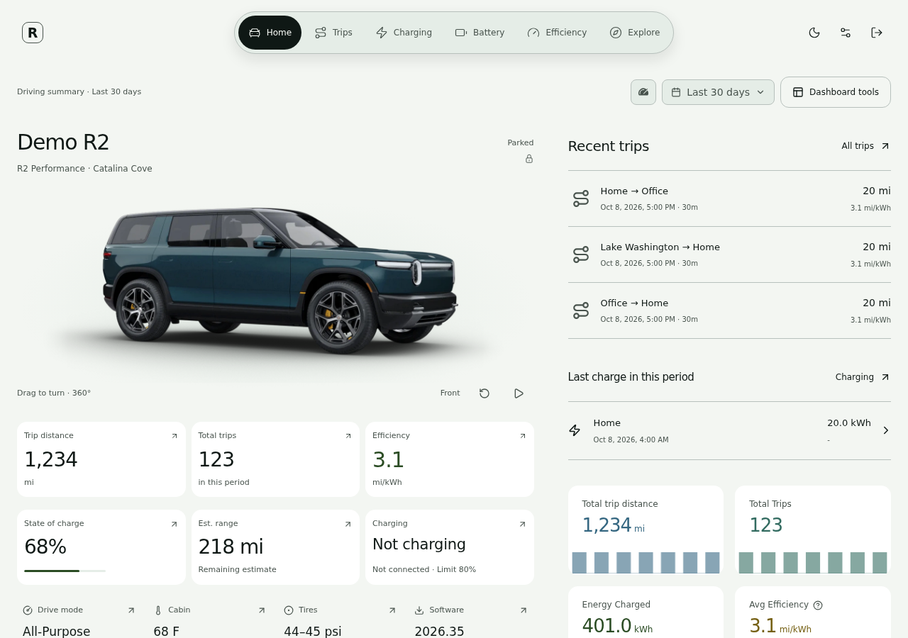
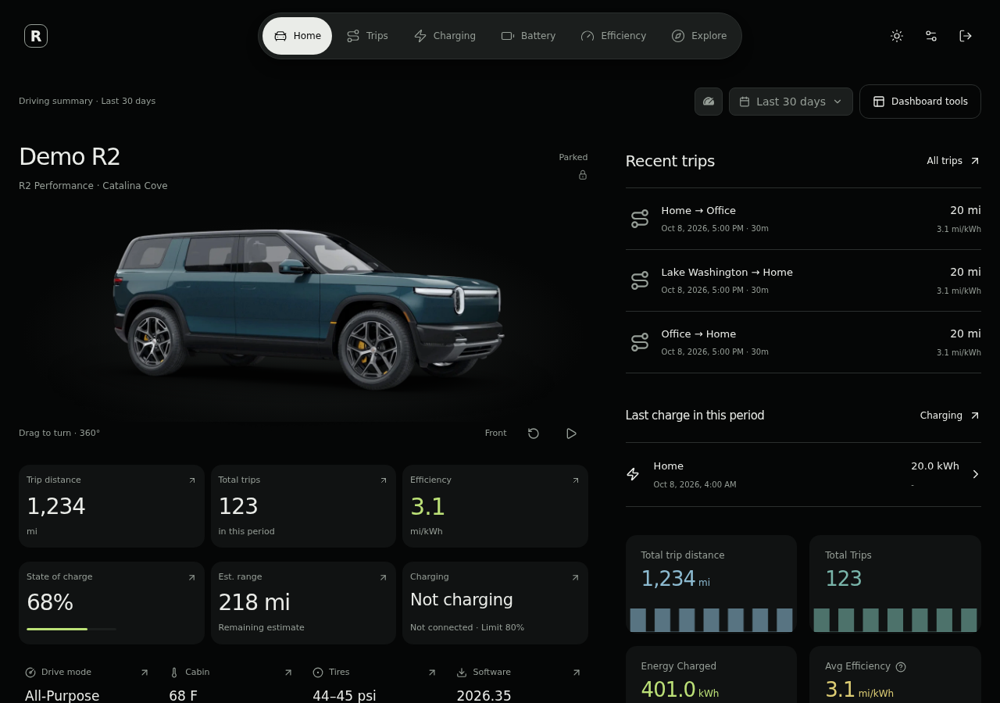
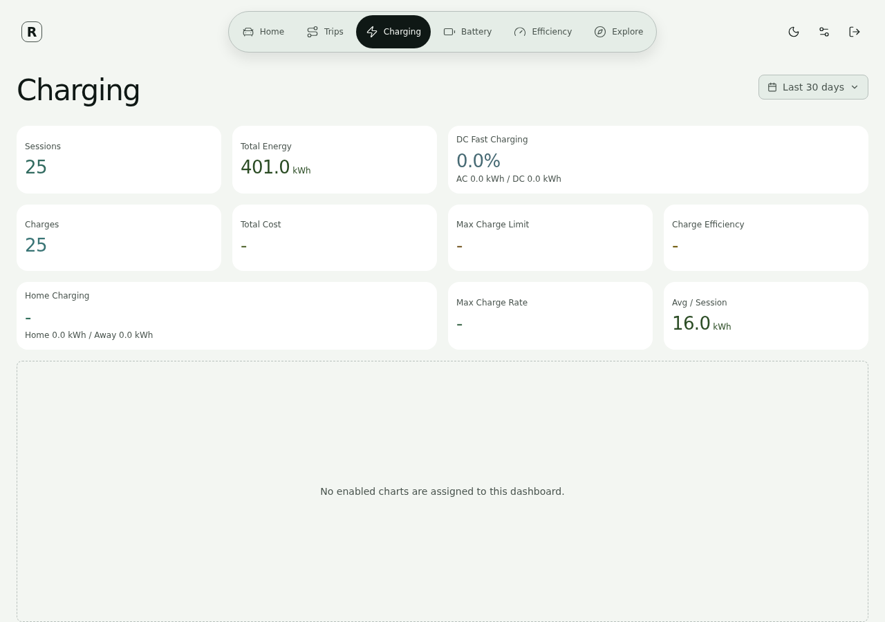
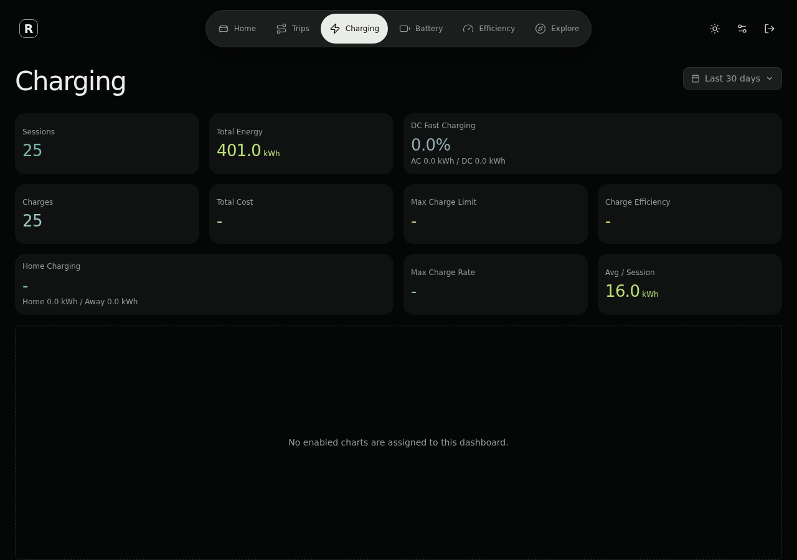
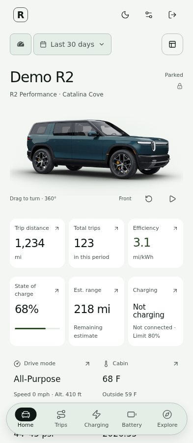
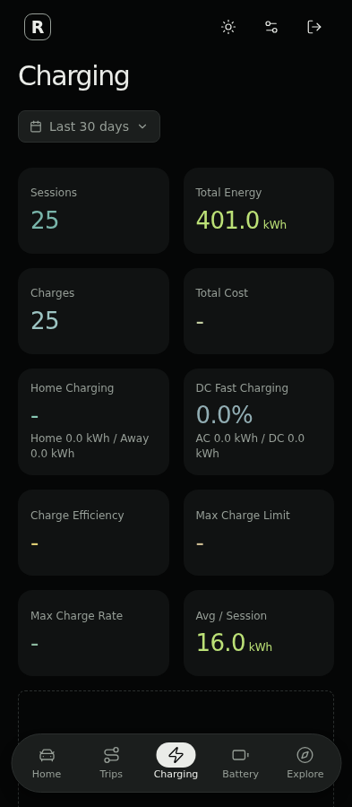

# R:The Drive

<p align="center">
  <picture>
    <source media="(prefers-color-scheme: dark)" srcset="./docs/assets/readme/logo-lockup-dark.png" />
    
  </picture>
</p>

**Your vehicle. Your history. Your server.**

R:The Drive is a private, self-hosted application for understanding your Rivian. See your vehicle at a glance, explore every recorded trip, follow charging and battery trends, and build dashboards around the information that matters to you. The responsive R interface works on desktop and mobile, with light and dark modes.

[Deploy with the setup script](./scripts/deploy.py) · [Installation guide](./docs/guides/getting-started.md) · [Documentation](./docs/index.md)

## What you can do

- **See your vehicle:** View charge level, estimated range, lock state, temperatures, tire pressure and software information alongside an interactive vehicle view.
- **Explore recorded trips:** Review routes, distance, duration, efficiency and driving samples. Tag trips and inspect the map and graphs together.
- **Understand charging:** Follow session history, charging curves, energy added and available cost information.
- **Track battery and efficiency:** Compare state of charge, range, parked battery loss, drive modes and longer-term trends.
- **Make it yours:** Customize dashboards, charts, units and saved places. Import, export or duplicate dashboard configurations.
- **Manage access:** Connect multiple vehicles, invite users and assign vehicle-specific owner, manager or viewer access.
- **Keep your history:** Store telemetry on your own infrastructure and use the backup and recovery tools to protect it.
- **Try sample data:** Create a demo R1T, R1S or R2 without connecting a vehicle account.

The application displays the readings Rivian makes available. Sleeping vehicles and unavailable signals can leave gaps; missing readings are not presented as measured values.

## Deploy in four steps

The [setup script](./scripts/deploy.py) builds the application, generates database and cache passwords, provisions signing and encryption keys, starts the services and guides you through first-owner setup.

**Before you start:** use a trusted server with Git, Python 3, Docker Engine and Docker Compose v2, plus persistent storage and enough resources for a Rust/frontend source build. Configure an authenticated HTTPS gateway on that host forwarding to `http://127.0.0.1:8080`. Domain registration, TLS and gateway access policies are covered in the [secure deployment guide](./docs/guides/secure-deployment.md); the script does not provision them.

1. **Get the application.**

   ```bash
   git clone <repository-url> r-the-drive
   cd r-the-drive
   ```

2. **Run the installer with your gateway address.**

   ```bash
   python3 scripts/deploy.py --project r-the-drive --origin https://vehicle.example.com
   ```

3. **Create your owner account.** Enter your email and a new password when prompted. Password entry is hidden. The installer registers the owner locally and removes the one-time setup proof.

4. **Open your HTTPS address and connect your Rivian.** Sign in with the owner account and complete vehicle-account authentication. Back up the `r-the-drive-keys` Docker volume separately using the [key-custody runbook](./docs/runbooks/key-custody.md).

Use a fresh installation with new storage and credentials. The script refuses to overwrite an installation or reuse its project volumes. Generated configuration is stored in an ignored, owner-only `.env` file; keys stay in a dedicated volume mounted read-only by the application.

To retry startup or owner creation after a transient failure:

```bash
python3 scripts/deploy.py start
```

The installer retains data and keys on failure. If preparation stopped before key generation, inspect the retained state before retrying. See the [installation guide](./docs/guides/getting-started.md) for details and the [deployment guide](./docs/guides/deployment.md) for updates and other deployment paths.

## A look inside

These screenshots use synthetic vehicle data.

| Desktop, light | Desktop, dark |
| --- | --- |
|  |  |

| Charging, light | Charging, dark |
| --- | --- |
|  |  |

| Mobile overview | Mobile charging |
| --- | --- |
|  |  |

## Security and privacy

R:The Drive includes account authentication, session controls, role and vehicle authorization, encrypted vehicle credentials, external key custody, private-origin gateway controls and protected history and recovery workflows. Vehicle connectivity is read-only.

Your telemetry lives in the database and backups you operate. There is no product analytics service. Connections to Rivian and optional map, weather, geocoding or backup providers make the external requests those features require; configure them in External Connections and review the [privacy details](./docs/privacy.md).

For setup and operating guidance, see [Security](./docs/security.md), [Secure deployment](./docs/guides/secure-deployment.md) and [Backup and restore](./docs/guides/backup-and-restore.md). Automated checks and local validation results are documented in [BOOTSTRAP_VALIDATION.md](./BOOTSTRAP_VALIDATION.md); hosted release automation requires separate configuration.

## Documentation and development

- [Documentation hub](./docs/index.md): installation, usage, operations and reference material.
- [Vehicle account setup](./docs/guides/rivian-account.md): connect an account and complete MFA or renewal.
- [Configuration](./docs/guides/configuration.md): environment variables, keys and optional services.
- [Development](./docs/development.md): architecture, dashboards, APIs and contributor guidance.
- [Contributor setup](./CLAUDE.md): local development commands and checks.

## License

Licensed under [GPL-3.0-only](./LICENSE).
See [Notices](./NOTICE.md) for attribution and the dated modification notice.
